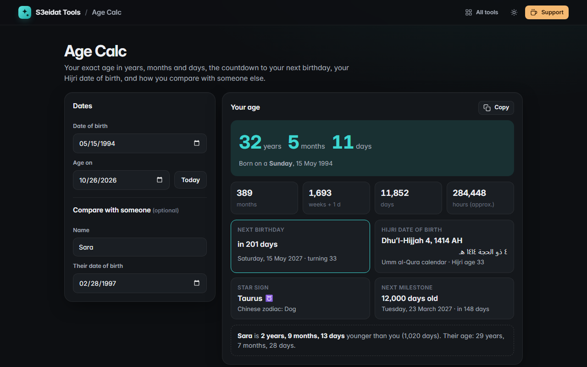

# Age Calc

> Exact age, next birthday, Hijri date of birth and fun stats. Free, private, and it runs entirely in your browser.

### ▶ [Open Age Calc](https://s3eidat.github.io/age-calc/)



## Features

- **Exact age** in years, months and days, on today or any other date
- Totals in **months, weeks, days and hours**
- **Next birthday** countdown with the weekday and the age you turn (Feb 29 birthdays fall on Feb 28 in common years)
- **Hijri date of birth** in English and Arabic (Umm al-Qura calendar, via your browser's built-in Intl) and your Hijri age
- **Star sign** and Chinese zodiac animal, the weekday you were born, and your next 1,000-day milestone
- **Compare two people**: who is older and by exactly how much
- Pure calendar arithmetic, so time zones and daylight saving never shift a day; copy a summary

Month arithmetic follows the usual convention: adding a month to the 31st lands on the last day of a shorter month.

## Privacy

Your dates never leave your device. There is no server, no account, no analytics.
The page ships with a strict Content-Security-Policy (`connect-src 'self'`), so the browser
itself blocks any attempt to send data anywhere.

## Run it yourself

It's plain HTML, CSS and JavaScript with no build step:

```bash
git clone https://github.com/s3eidat/age-calc
cd age-calc
python -m http.server 8000
```

Then open http://localhost:8000.

## Support

If this saved you time, **[buy me a coffee ☕](https://s3eidat.github.io/coffee/)**. It keeps every tool free.

---

Part of **[S3eidat Tools](https://s3eidat.github.io/)**: 100+ free, private tools that run in your browser. MIT licensed.
